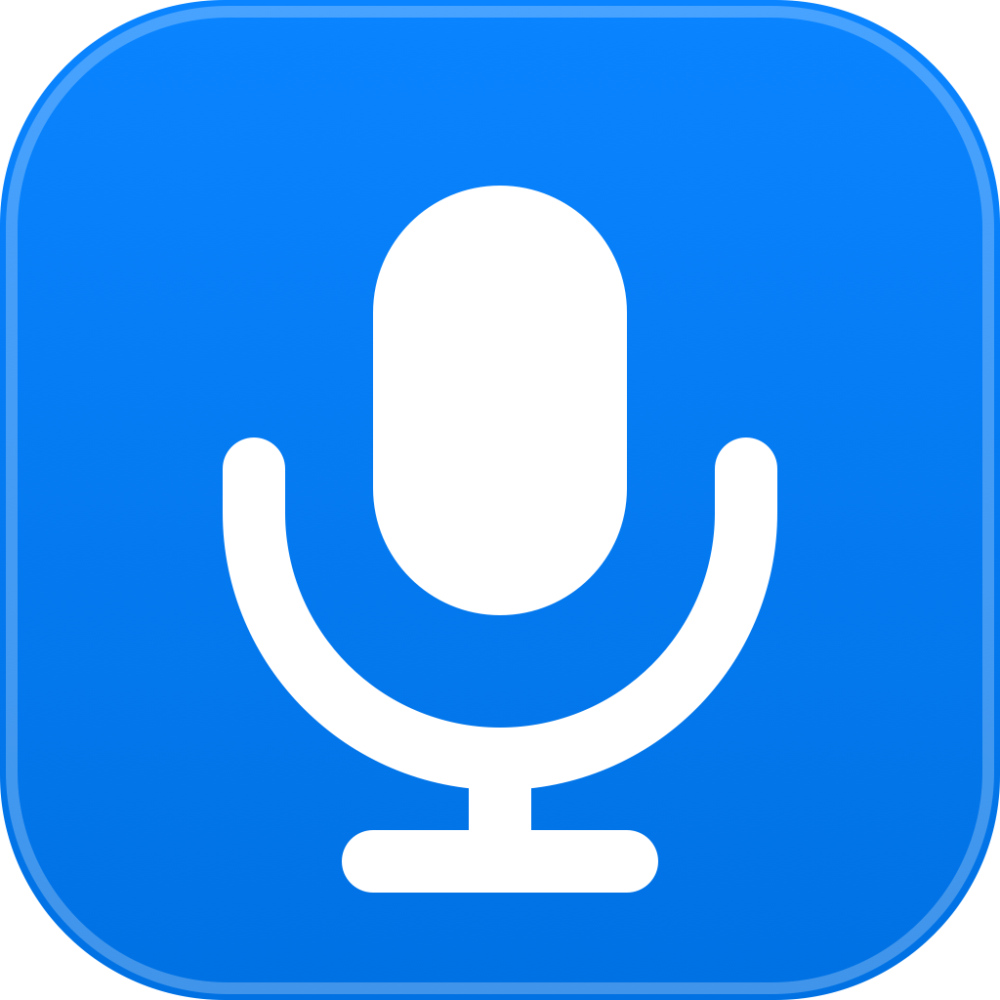

<p align="center">
  
</p>

<h1 align="center">MacVoice — Type at the Speed of Thought</h1>

<p align="center">
  <strong>The ultra-lightweight, local-first voice keyboard for macOS.</strong><br>
  Pure Swift native application. Sub-150ms live cursor streaming. Zero cloud servers.<br>
  Translates speech into genuine hardware-level keystrokes that flow into any app in real time.
</p>

<p align="center">
  <a href="https://macvoice.app"></a>
  
  
  
  
</p>

---

## 💡 What is MacVoice?

MacVoice is an independent, native macOS utility engineered for software engineers, writers, and power users. 

Focus any text box in VS Code, Slack, Word, Notes, or Safari, press <kbd>Control</kbd> + <kbd>Option</kbd> + <kbd>Space</kbd>, and speak. MacVoice synthesizes genuine physical keyboard events directly into the macOS WindowServer at your cursor position.

Unlike common dictation software that dumps transcribed text into your clipboard (`NSPasteboard`) and simulates `Cmd+V`, MacVoice dispatches authentic hardware keypresses (`CGEvent` directly posted to `.cghidEventTap`). It **bypasses copy-paste restrictions on secure forms**, never overwrites your clipboard, and processes 100% of audio locally in RAM without cloud dependencies.

---

## ⚡ Key Architectural Capabilities

- ⌨️ **Simulated Hardware Typing:** Emits Quartz HID `.cghidEventTap` key-down/up pairs. Works inside secure banking portals, proctored exams, and remote desktops (Citrix/VDI) where paste is blocked by `onpaste="return false;"`.
- 🚀 **Sub-150ms Live Streaming:** Dispatches confirmed words progressively to the active text field while speaking. Zero batch delay.
- 🪄 **In-Process Swift Polish (<0.1ms):** Strips vocal hesitations ("um", "uh"), normalizes unpunctuated contractions ("dont" → "don't"), and formats capitalization in resident memory with zero extra RAM.
- 💬 **Chat-Safe Line Breaks:** Bundle introspection detects active messaging apps (Slack, WhatsApp, Teams, Discord, Telegram) and automatically sends `Shift + Return` on "new line" to prevent accidental message transmission.
- 🔒 **100% Air-Gapped Audio:** Integrates directly with Apple's modern on-device `SpeechAnalyzer` framework. Zero network sockets. Zero telemetry.
- 🪶 **784 KB Package, ~60 MB RAM:** Pure native Swift compiled for Apple Silicon (arm64). Zero Python, zero Electron, zero local LLM downloads.

---

## 📊 Comparison Against Alternatives

| Capability | MacVoice | Apple Dictation | Wispr Flow | Superwhisper |
| :--- | :--- | :--- | :--- | :--- |
| **Typing Mechanism** | **Quartz CGEvent HID (Hardware Keystrokes)** | Accessibility insertion | Clipboard paste (`Cmd+V`) | Clipboard paste (`Cmd+V`) |
| **Works Where Paste is Blocked** | **Yes (Immune to restrictions)** | Partial | ❌ Fails completely | ❌ Fails completely |
| **Preserves Clipboard Data?** | **Yes (Never touches clipboard)** | Yes | ❌ Overwrites clipboard | ❌ Overwrites clipboard |
| **Removes "Um" & "Uh"** | **Instant (<0.1ms Swift)** | ❌ None (types stutters) | Cloud LLM | Local LLM |
| **Typing Latency** | **< 150ms Live Streaming** | ~200ms | ~1.0s cloud loop | 2.5s batch wait |
| **Chat Safety (Shift+Return)** | **Yes (Chat-Aware)** | ❌ Sends message early | ❌ Sends message early | ❌ Sends message early |
| **Audio Privacy** | **100% On-Device (0 bytes cloud)** | Apple Cloud / Local | Cloud GPU servers | 100% On-Device |
| **App Size & RAM** | **784 KB (~60 MB RAM)** | Built-in | ~80 MB (~180 MB RAM) | 1.5 GB+ (500 MB–1.8 GB RAM) |
| **Pricing** | **$9 USD One-Time** | Free with macOS | $144 / year subscription | $250 lifetime |

---

## 🛠 Building from Source

### Requirements
- Apple Silicon Mac (M1, M2, M3, M4)
- macOS 26.0 or later
- Xcode Command Line Tools (`xcode-select --install`)
- Swift 6.0+

### Build & Run
```bash
# Clone the repository
git clone https://github.com/Akshatthakur22/Typer.git
cd Typer

# Build the release application bundle
bash scripts/build_voice_typing_app.sh

# Or create a compressed release DMG
bash scripts/create_dmg.sh
```

The output DMG is generated at `dist/MacVoice.dmg`.

---

## 👨‍💻 Created by

Crafted with care by **Akshat Thakur**.

- **Website:** [akshatt.in](https://akshatt.in/)
- **GitHub:** [@Akshatthakur22](https://github.com/Akshatthakur22)
- **LinkedIn:** [linkedin.com/in/akshatthakur22](https://www.linkedin.com/in/akshatthakur22/)
- **Email:** [akshatthakur22@gmail.com](mailto:akshatthakur22@gmail.com)

---

<p align="center">
  <sub>© 2026 MacVoice. Built for software engineers, writers, and Mac power users. Apple, Mac, and macOS are trademarks of Apple Inc.</sub>
</p>
