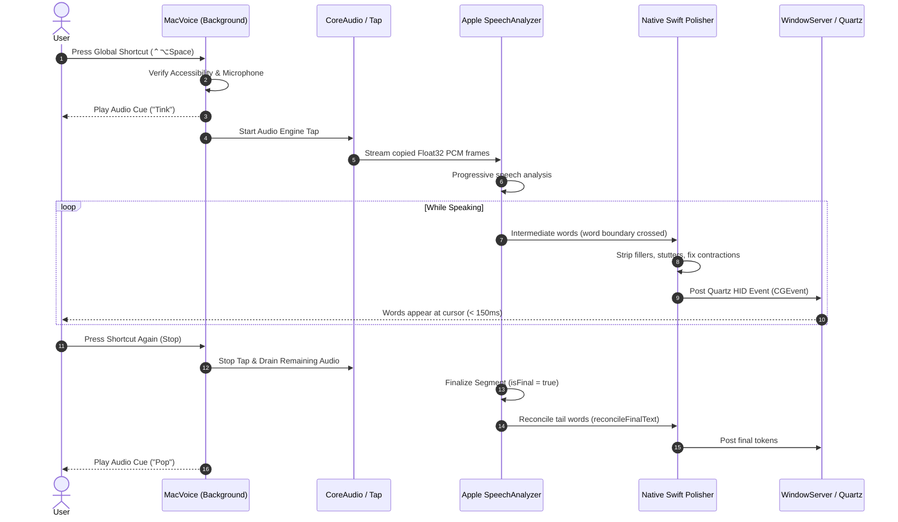

# MacVoice: Product Overview & Core Intelligence Document

**Document Version:** 1.0.0  
**Research Date:** October 31, 2026  
**Auditor / Roles:** Senior macOS Software Architect & Desktop Product Strategist  
**Classification:** Foundational Product Intelligence  

---

## 1. Executive Summary: What is MacVoice?

**MacVoice** is an ultra-lightweight, native, local-first voice typing utility designed exclusively for macOS. It allows users to press a global keyboard shortcut (default: `⌃⌥Space`), speak naturally, and have their spoken words typed directly at the active cursor across any macOS application—including code editors (VS Code, Xcode), terminals (iTerm2, Terminal), web applications (Chrome, Safari), and team messengers (Slack, WhatsApp, Discord, Telegram).

Unlike cloud-dependent voice dictation platforms (such as Wispr Flow or Aqua Voice) that charge recurring subscriptions and transmit microphone audio over the internet, MacVoice operates **100% on-device** using Apple Silicon's native Speech engine. 

Unlike heavy local Whisper-based utilities (such as Superwhisper or VoiceInk) that require gigabytes of neural model downloads and hundreds of megabytes of RAM, MacVoice is a tiny **1.5 MB application bundle** that runs in **~60 MB of RAM** with **zero external dependencies**.

---

## 2. The Core Problems It Solves

Mac users who want to write and dictate by voice face a frustrating three-way dilemma in the current market:

```
                          THE VOICE TYPING DILEMMA
                         
                 [ Heavy Cloud SaaS: Wispr Flow, Aqua ]
                 • $144–$180/year recurring subscription
                 • Transmits corporate/confidential audio to cloud
                 • Requires continuous high-speed internet
                               ▲
                              / \
                             /   \
                            /     \
                           /  ???  \
                          /         \
                         ▼           ▼
[ Built-In Apple Dictation ]        [ Heavy Local Tools: Superwhisper ]
• Transcribes "um", "uh", stutters   • 100 MB–250 MB app download
• Invasive floating mic widget      • Requires 1 GB–3 GB model weights
• Locks up in VS Code & Terminals   • High RAM (~500 MB+) & battery drain
• Rigid, unconfigurable shortcuts   • $85/year or $250 lifetime license
```

### Problem 1: Apple’s Built-in Dictation is Dumb and Intrusive
* **Transcribes Speech Garbage:** Apple Dictation types out every vocal hesitation, cough, *"um"*, *"uh"*, and repeated stutter word into professional documents.
* **Intrusive Screen Clutter:** It pops up a floating microphone bubble that steals focus, obscures text, and frequently fails to disappear.
* **Breaks in Non-Apple Apps:** It relies on macOS Input Method (IME) overlays that lock up, drop text, or fail in cross-platform/Electron apps (VS Code, Slack, Obsidian, Chrome textareas).

### Problem 2: Cloud Dictation Tools are Expensive and Threaten Privacy
* Tools like **Wispr Flow** ($15/mo) and **Aqua Voice** ($10/mo) deliver polished text by streaming voice recordings to remote cloud servers.
* For software developers, lawyers, doctors, executives, and privacy-conscious users, transmitting confidential source code, trade secrets, private patient notes, or client emails to a third-party server is a severe security violation.
* Furthermore, a 2,000-word/week cap on free tiers forces users into a $144+/year commitment.

### Problem 3: Existing Local AI Tools are Resource-Intensive
* Utilities like **Superwhisper** attempt local execution by bundling OpenAI Whisper checkpoints.
* This demands massive downloads (500 MB to 3 GB+ of model weights), consumes 500 MB to 1 GB of unified memory, and causes noticeable battery drain and fan noise on MacBook Airs.

### How MacVoice Solves This
MacVoice introduces a **lightweight, privacy-first alternative**:
1. **Zero External Dependencies:** Built into a 1.5 MB native Swift app. No Python, no virtualenvs, no HuggingFace downloads.
2. **Sub-150ms Live Streaming:** Words stream directly to the cursor at word boundaries while the user is actively speaking.
3. **In-Process Smart Polishing:** Removes fillers (`um`, `uh`), collapses stutters, and fixes capitalization in **< 0.1 ms** with **0 MB extra RAM**.
4. **Chat-Aware Safety:** Automatically detects whether the active window is a messaging app (WhatsApp, Slack, Discord) and uses `Shift + Return` instead of `Enter`, preventing premature message submission.
5. **Universal Cursor Insertion:** Uses Quartz HID CGEvents at the system level, typing reliably into every text box in macOS.

---

## 3. Implemented Capabilities (Status Verification)

| Capability | What It Does in the App | Verification Status | Source Reference |
| :--- | :--- | :---: | :--- |
| **Global Activation Shortcut** | Listens globally for key combo (Default: `⌃⌥Space`). Can be recorded and remapped. | **VERIFIED** | `GlobalShortcut.swift:15-120` |
| **Progressive Live Streaming** | Emits confirmed words at word boundaries during active speech (< 150ms latency). | **VERIFIED** | `AppleSpeechAnalyzerRecognizer.swift:314-335` |
| **Append-Only Finalization Safety** | `reconcileFinalText` guarantees segment finalization never violates reconciler prefix invariant. | **VERIFIED** | `AppleSpeechAnalyzerRecognizer.swift:344-378` |
| **Verbatim Mode** | Pure pass-through: speech tokens emitted directly with zero modification. | **VERIFIED** | `VoiceTypingSession.swift:188-193` |
| **Native Swift Polished Mode** | Cleans fillers (`um`, `uh`), eliminates stutters, normalizes contractions (`dont` $\to$ `don't`). | **VERIFIED** | `TranscriptPolisher.swift:16-105` |
| **Explicit Voice Navigation** | Converts `"new line"` $\to$ `\n`, `"new paragraph"` $\to$ `\n\n`, `"bullet point "` $\to$ `\n- `. | **VERIFIED** | `TranscriptPolisher.swift:33-36` |
| **Chat-Aware Newlines** | Detects active app bundle; sends `Shift + Return` in Slack, WhatsApp, Discord, Telegram. | **VERIFIED** | `TypingEngine.swift:66-96` |
| **Zero-Allocation Audio Tap** | Pre-allocated `AVAudioPCMBuffer` & `AVAudioConverter` instances eliminate ~5,600 allocs/min. | **VERIFIED** | `AppleSpeechAnalyzerRecognizer.swift:170-245` |
| **Hardware Hot-Plugging** | Listens to `AVAudioEngineConfigurationChangeNotification` to survive AirPods connect/disconnect. | **VERIFIED** | `AudioCapture.swift:16-45` |
| **Sleep/Wake Protection** | Pauses session on `NSWorkspace.willSleepNotification` and resets cleanly on wake. | **VERIFIED** | `main.swift:153-186` |
| **Secure Input Detection** | Checks `IsSecureEventInputEnabled()` in Carbon to notify users rather than drop events. | **VERIFIED** | `TypingEngine.swift:141-143` |
| **Live Accessibility Polling** | `accessibilityPollTimer` polls `CGPreflightPostEventAccess()` every 0.5s so no restart is needed. | **VERIFIED** | `main.swift:745-770` |
| **Launch at Login** | Native macOS toggle using modern `SMAppService.mainApp.register()`. | **VERIFIED** | `main.swift:783-796` |
| **Audio Feedback Cues** | Subtle native system audio cues ("Tink" on start, "Pop" on stop). | **VERIFIED** | `main.swift:853-868` |
| **In-App Test Sandbox** | Interactive sandbox field inside the settings window for immediate first-run testing. | **VERIFIED** | `main.swift:274-282` |

---

## 4. End-to-End User Experience



### User Activation & Control
1. **Activation:** The user focuses any text area in any macOS application and presses **`⌃⌥Space`** (or clicks the menu bar item).
2. **Feedback:** A crisp, subtle system sound ("Tink") plays immediately, and the menu bar status changes to **Listening** (with a red indicator).
3. **Live progressive streaming:** Within ~150ms of uttering the first few words, words stream into the focused app.
4. **Deactivation:** The user presses `⌃⌥Space` again. A gentle "Pop" sound plays, final words are reconciled and flushed, and the app returns to **Ready** in ~50ms.
5. **No Window Interruption:** Unlike Apple Dictation or Siri, there is no floating overlay covering text, no cursor hijacking, and no dock bouncing.

---

## 5. Technical Architecture Explained Simply

The MacVoice architecture is organized into four clean, isolated layers:

```
┌─────────────────────────────────────────────────────────────┐
│ 1. INPUT & CONTROL LAYER                                   │
│    • Carbon Global Event Hotkey (⌃⌥Space)                   │
│    • NSStatusItem Menu Bar Controller                        │
│    • Native AppKit Settings & Onboarding Window             │
│    • SMAppService Launch-at-Login                           │
└──────────────────────────────┬──────────────────────────────┘
                               │ triggers
┌──────────────────────────────▼──────────────────────────────┐
│ 2. RESILIENT AUDIO CAPTURE LAYER                            │
│    • AVAudioEngine hardware tap                             │
│    • ConfigurationChange listener (AirPods hot-plugging)    │
│    • Zero-allocation Float32 interleaved PCM frame buffer   │
└──────────────────────────────┬──────────────────────────────┘
                               │ raw PCM frames
┌──────────────────────────────▼──────────────────────────────┐
│ 3. SPEECH RECOGNITION & RECONCILIATION LAYER                │
│    • Apple SpeechAnalyzer / SpeechTranscriber (macOS 26+)   │
│    • Progressive word-boundary hypothesis extraction        │
│    • TranscriptReconciler: Append-only UTF-8 delta guard    │
│    • reconcileFinalText: Segment finalization alignment     │
└──────────────────────────────┬──────────────────────────────┘
                               │ confirmed deltas
┌──────────────────────────────▼──────────────────────────────┐
│ 4. POLISHING & QUARTZ EMISSION LAYER                        │
│    • NativeSwiftTranscriptPolisher (< 0.1ms latency)        │
│    • Chat-aware newline resolver (Shift+Enter vs Return)    │
│    • Quartz CGEvent HID keyboard injection                  │
└─────────────────────────────────────────────────────────────┘
```

1. **Input & Control Layer (`VoiceTypingApp`):** Runs an accessory (`LSUIElement = true`) menu bar application. Listens for the global hotkey via Carbon Events without stealing focus from the active app.
2. **Audio Capture Layer (`AudioCapture`):** Manages the microphone tap using `AVAudioEngine`. Copies hardware audio into pre-allocated memory buffers to keep CoreAudio's real-time thread glitch-free.
3. **Speech Recognition Layer (`AppleSpeechAnalyzerRecognizer`):** Passes PCM frames to Apple's on-device `SpeechTranscriber`. Tracks word boundaries progressively to emit hypotheses live, then uses `reconcileFinalText` when Apple finalizes segments to guarantee strict append-only safety.
4. **Polishing & Emission Layer (`TypingCore` & `TranscriptPolisher`):** Normalizes text in memory (stripping fillers and fixing capitalization), checks whether the active app is a chat client (substituting `Shift + Return` if needed), and posts hardware-level Quartz keyboard events directly to macOS WindowServer.

