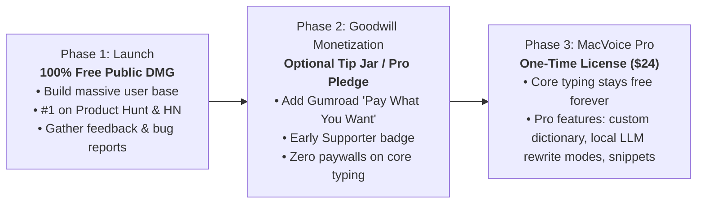

# MacVoice: Pricing Strategy, Unit Economics & Business Model Analysis

**Document Version:** 1.0.0  
**Research Date:** October 31, 2026  
**Auditor / Roles:** SaaS & Independent Software Business Analyst  
**Classification:** Financial Strategy & Commercial Feasibility Dossier  

---

## 1. Executive Financial Summary

MacVoice possesses an extraordinary structural advantage over virtually every competitor in the modern software landscape:

> **Zero Cloud Server Costs (COGS = $0.00 per user).**

Because MacVoice executes speech transcription and native text polishing 100% on-device using the host Mac's hardware (Apple Silicon CPU/ANE), **serving 1,000,000 active users costs the exact same infrastructure expense as serving 1 user: zero dollars.**

This zero marginal cost structure unlocks complete flexibility in selecting a business model. While cloud competitors (Wispr Flow) are trapped in recurring subscriptions to pay for GPU inference, MacVoice can adopt developer-beloved distribution models that create massive organic viral adoption.

---

## 2. Business Model Evaluation

We analyzed four commercial models for MacVoice:

| Model | User Perception | Conversion Potential | Operational Complexity | Strategic Fit for Initial Launch |
| :--- | :---: | :---: | :---: | :---: |
| **Model 1: 100% Free / Free Binary** | Extremely High (Universal Goodwill) | Maximum (Zero friction) | Minimal (No payment gateway, no licenses) | **RECOMMENDED FOR LAUNCH (Phase 1)** |
| **Model 2: One-Time Purchase ($19–$29)** | High (Beloved Mac indie model) | Moderate (Requires payment upfront) | Low (LemonSqueezy / Gumroad / Paddle) | **RECOMMENDED FOR POST-LAUNCH (Phase 2)** |
| **Model 3: Recurring Subscription ($5/mo)** | Low (Heavy subscription fatigue) | Low (Users resist SaaS for local tools) | High (Churn management, billing support) | **NOT RECOMMENDED** |
| **Model 4: Freemium / Pro Expansion** | Very High (Generous free tier + power tools) | High (Natural upgrade path) | Moderate (License key entitlement engine) | **RECOMMENDED FOR LONG-TERM (Phase 3)** |

---

### Detailed Model Analysis

### Model 1: 100% Free Public Launch (The "Raycast / Shottr" Playbook)
* **How it works:** Distribute the full-featured MacVoice DMG for free. Anyone can download and use it with zero restrictions, zero account creation, and zero paywalls.
* **Why it works:**
  * Eliminates 100% of conversion friction on launch day.
  * Captures market share instantly from frustrated Wispr Flow users who hit their 2,000-word limit.
  * Sparks organic viral sharing on Hacker News, Reddit (`r/macapps`, `r/productivity`), Product Hunt, and developer Twitter/X.
  * Establishes MacVoice as the standard on-device utility before competitors can adapt.

### Model 2: The Beloved "Pay-Once, Own-Forever" Utility
* **Benchmark:** Shottr ($12), CleanShot X ($29), Magnet ($9.99), DaisyDisk ($9.99).
* **Price Point:**
  * **Global / US:** **$19 – $29 USD** (One-time purchase for 1 year of updates + lifetime use).
  * **India (Purchasing Power Parity):** **₹1,499 – ₹1,999 INR**.
* **Why it works:** Mac users passionately despise recurring subscriptions for desktop utilities that do not run cloud servers. Offering a one-time purchase builds profound community loyalty and generates immediate upfront cash flow.

### Model 3: The Recurring SaaS Subscription (Why to Avoid)
* **Benchmark:** Wispr Flow ($15/mo), Superwhisper ($8.49/mo).
* **Strategic Verdict:** **Strongly Discouraged.**
  Charging a monthly subscription for an app with zero cloud server expenses creates immediate cognitive dissonance. Tech-savvy Mac users quickly inspect network traffic, realize the app runs locally, and reject the subscription as rent-seeking.

---

## 3. Cost of Goods Sold (COGS) & Fixed Operating Expenses

Because the product is 100% local, the operating expense profile is remarkably minimal:

### Fixed Annual Expenses
* **Apple Developer Program Fee:** $99 / year (required for Developer ID codesigning & Notarization).
* **Domain Name (`macvoice.app` or similar):** $15 – $35 / year.
* **Website Hosting & CDN (Cloudflare Pages / Vercel):** $0.00 / year (Free tier easily handles millions of static DMG downloads).
* **Total Fixed Annual Operating Overhead:** **~$120 USD / year**.

### Variable Expenses per User
* **Speech Recognition Cloud Compute:** $0.00.
* **LLM Polishing API Calls:** $0.00.
* **Database & Storage Costs:** $0.00.
* **Payment Processing Fee (LemonSqueezy / Paddle):** 5% + $0.50 per transaction (only applicable when charging).

**Gross Profit Margin:** **~98.5%**.

---

## 4. Recommended Staged Monetization Strategy

To balance rapid market capture with long-term commercial sustainability, we recommend a **Three-Phase Strategy**:

### Phase 1: Launch Week to Month 2 (Hyper-Growth)
* Release MacVoice as a **free download DMG**.
* Position it proudly: *"No cloud, no accounts, no subscriptions. Built for Mac power users."*
* Goal: 20,000+ downloads, top rankings on Product Hunt, widespread praise on Hacker News.

### Phase 2: Month 3 to Month 6 (Community Backing)
* Add a simple *"Support MacVoice Development"* button in the settings window linking to LemonSqueezy / GitHub Sponsors / Buy Me a Coffee ($5, $15, $30 optional supporter tiers).
* Typically converts 2–5% of enthusiastic developer users into paying supporters.

### Phase 3: Month 6+ (Freemium Power Tier)
* Introduce **MacVoice Pro** ($24 one-time purchase):
  * **Free Forever:** Core progressive speech dictation, native polisher, filler removal, chat-aware newlines, global shortcut, unlimited words.
  * **Pro Tier Additions:** Custom replacement dictionary (e.g., auto-expanding technical acronyms, personal names), custom voice commands (e.g., *"commit message"*, *"bullet list"*), and multi-lingual quick toggle.

---

## 5. Twelve-Month Revenue Projections

The following financial models simulate three adoption scenarios over the first 12 months, assuming a transition to the Phase 3 Freemium / One-Time Purchase model ($24 license) after month 3:

### Assumptions:
* **Website Visitors / Month:** Conservative: 10,000 | Realistic: 35,000 | Optimistic: 100,000.
* **Visitor-to-Download Conversion:** 18% (high conversion due to < 1 MB download and free friction-free DMG).
* **Free-to-Pro License Conversion Rate:** 3.5% of active users.
* **Net Price per License:** $22.30 (after 5% + $0.50 payment processor deduction on $24 price point).

| Metric | Conservative Scenario | Realistic Scenario | Optimistic Scenario |
| :--- | :---: | :---: | :---: |
| **Annual Website Visitors** | 120,000 | 420,000 | 1,200,000 |
| **Total Free DMG Downloads** | 21,600 | 75,600 | 216,000 |
| **Active Retained User Base** | 8,640 (40%) | 34,020 (45%) | 108,000 (50%) |
| **Pro License Purchases (3.5%)** | 756 | 2,646 | 7,560 |
| **Gross Revenue** | **$18,144** | **$63,504** | **$181,440** |
| **Payment Processing (LemonSqueezy)** | ($1,285) | ($4,500) | ($12,850) |
| **Operating Expenses (Apple Dev, Hosting)** | ($150) | ($250) | ($500) |
| **Net Founder Profit (USD)** | **$16,709** | **$58,754** | **$168,090** |
| **Net Founder Profit (INR @ ₹84/$)** | **₹14.0 Lakhs** | **₹49.3 Lakhs** | **₹1.41 Crores** |

### Strategic Takeaway
Even under the Conservative Scenario, MacVoice yields over **$16,000 USD (~₹14 Lakhs INR)** in net founder profit with **almost zero ongoing server maintenance or operational headaches**. Under the Realistic Scenario, it develops into a healthy **$58,000+ USD (~₹49 Lakhs INR)** solo indie business.

