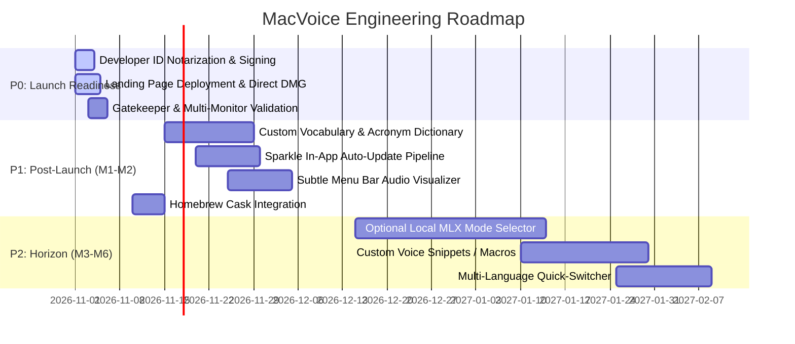

# MacVoice: Product Roadmap & Engineering Evolution

**Document Version:** 1.0.0  
**Research Date:** October 31, 2026  
**Auditor / Roles:** Senior macOS Software Architect & Head of Product  
**Classification:** Product Strategy & Engineering Roadmap  

---

## 1. Executive Roadmap Principles

To maintain MacVoice’s decisive competitive advantages—microscopic size (784 KB), blistering speed (< 150 ms), zero extra RAM, and bulletproof privacy—all future product development must adhere to three foundational rules:

1. **Native Swift Only:** Never introduce Electron, web wrappers, or bloated third-party frameworks.
2. **Zero Cloud Dependencies:** All features must operate 100% on-device. Audio must never leave the user’s computer.
3. **Cursor-First Focus:** MacVoice is a high-speed input utility that types into external applications. It is not an audio recording studio, podcast transcriber, or note-taking database.

---

## 2. Prioritized Roadmap Matrix

---

## 3. Detailed Phase Breakdown

### P0: Immediate Launch Readiness (Next 7 Days)

| Initiative | Description & Scope | Architectural Impact |
| :--- | :--- | :--- |
| **Developer ID Notarization** | Submit `MacVoice.app` and `MacVoice.dmg` to Apple's `notarytool` with a valid Developer ID Application certificate. | Eliminates macOS Gatekeeper security warnings (*"Apple cannot check it for malicious software"*). Guarantees frictionless install. |
| **Production Landing Page** | Deploy high-speed static landing page (`macvoice.app`) to Cloudflare Pages with direct DMG download button and MP4 demo loop. | Drives primary conversion funnel from Day 1. |
| **Multi-Monitor Menu Bar Testing** | Verify menu bar item visibility, status symbol tinting, and shortcuts across multi-monitor setups and full-screen Mission Control spaces. | Ensures rock-solid reliability for pro developer setups. |

---

### P1: Post-Launch Fast-Follows (Month 1 – Month 2)

| Initiative | Description & Scope | Architectural Impact |
| :--- | :--- | :--- |
| **Custom Vocabulary & Acronym Dictionary** | Allow users to define a custom word mapping in Settings (e.g., *"k8s"* $\to$ `"Kubernetes"`, *"pg"* $\to$ `"PostgreSQL"`, custom team member names). | Implemented directly inside `NativeSwiftTranscriptPolisher.swift` via an efficient trie or dictionary lookup. 0 ms added latency. |
| **In-App Auto-Updater (Sparkle)** | Integrate the battle-tested, lightweight [Sparkle](https://sparkle-project.org/) framework for seamless background updates with EdDSA cryptographic signatures. | Keeps users updated with bug fixes and new macOS compatibility without requiring manual DMG redownloads. |
| **Subtle Audio Activity Visualizer** | Animate the menu bar icon during active listening (e.g., subtle soundwave pulses) so users have immediate peripheral awareness of microphone activity. | Zero screen clutter; replaces intrusive floating bubbles used by competitors. |
| **Homebrew Cask Publication** | Submit `macvoice.rb` to `homebrew/cask` so developers can run `brew install --cask macvoice`. | Drastically lowers friction for developer adoption. |

---

### P2: Future Horizon & Pro Expansion (Month 3 – Month 6)

| Initiative | Description & Scope | Architectural Impact |
| :--- | :--- | :--- |
| **Specialized Formatting Modes (Optional MLX)** | Enable optional power modes for users who desire LLM restructuring: *"Bullet List Mode"*, *"Email Mode"*, or *"Code Comment Mode"*. | Utilizes an optional downloadable local model (e.g. Qwen2.5-0.5B via MLX) while keeping the core native Swift polisher as the default. |
| **Voice Snippets & Expanders** | Speak custom triggers like *"my meeting link"* or *"bug template"* to expand pre-defined snippets directly into the cursor. | Extends `TypingEngine.swift` with template expansion. |
| **Multi-Language Quick-Toggle** | Add a simple menu bar dropdown allowing bilingual users to instantly toggle the active recognition locale between English, Spanish, German, Japanese, etc. | Reconfigures `AppleSpeechAnalyzerRecognizer` with the new `Locale` dynamically. |

---

## 4. The Anti-Roadmap ("What We Will NOT Build")

To prevent scope creep and preserve product excellence, the following feature requests are explicitly rejected:

1. **❌ NO Cross-Platform / Windows / Linux Rewrite:**
   * MacVoice is built specifically for macOS, leveraging Apple Silicon, Quartz HID, Carbon hotkeys, and Apple Neural Engine. Porting to Windows or Linux would require sacrificing its native speed and 1.5 MB size.
2. **❌ NO Cloud Audio Sync or Web Dashboard:**
   * Adding cloud syncing would violate our core privacy pillar and introduce ongoing server hosting costs.
3. **❌ NO Full-Fledged Audio Recording / Podcast Transcriber:**
   * Apps like MacWhisper and Descript already cater to audio file transcription. MacVoice remains strictly a real-time cursor typing utility.
4. **❌ NO Intrusive Floating Screen Bubbles:**
   * We will never cover the user's active code editor or documents with annoying floating overlays.

